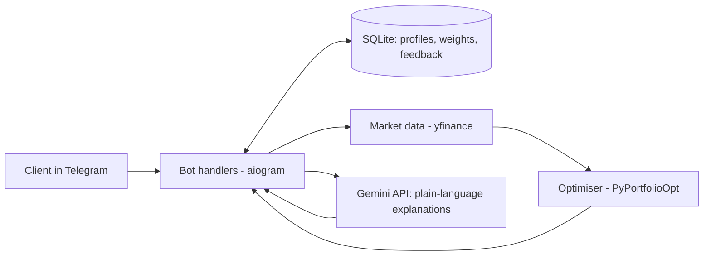

# PortfolioPal

**A Telegram bot demo of an AI co-pilot for wealth advisers.**
It profiles a client's risk level, builds an optimised portfolio from real market data, stress-tests it, flags when it needs rebalancing, and explains the results in plain language with Gemini AI.

> **Disclaimer:** This is an educational demo. It is not investment advice. Past performance does not predict future results.

## Why I built it

I wanted to understand how an AI-assisted advisory workflow works end to end: collect client needs, build a portfolio, test it, explain it, and gather feedback. The bot also includes pre-sales style features (needs analysis, troubleshooting FAQ, feedback collection) to show how such a tool could be demonstrated and supported during a client trial.

## Features

| Command | What it does |
|---|---|
| `/profile` | 4-question risk questionnaire. Gives a score out of 12 and a profile: Conservative, Balanced or Growth |
| `/portfolio` | Downloads 3 years of prices for 6 ETFs, optimises the weights for the client's profile, shows expected return, volatility and Sharpe ratio, then adds an AI explanation |
| `/scenario` | Stress test: equity market -20%, interest rates +1%, equity rally +15% |
| `/rebalance` | Checks how far each asset has drifted from its target weight and suggests a rebalance when drift exceeds 5 percentage points |
| `/needs` | Needs analysis: 3 questions about a firm, then an AI-drafted solution outline |
| `/faq` | Trial troubleshooting guide |
| `/feedback` | Saves client feedback to the database |

## How it works



1. **Risk profile.** Each answer scores 1 to 3 points. 4-6 is Conservative, 7-9 is Balanced, 10-12 is Growth.
2. **Optimisation.** Mean-variance optimisation over SPY, QQQ, 2800.HK, AGG, GLD and VNQ. Conservative uses the minimum-volatility portfolio. Balanced and Growth maximise the Sharpe ratio. A maximum weight per asset (35%, 40%, 55%) keeps the portfolio diversified.
3. **Scenarios.** Fixed, illustrative shocks per asset are applied to the portfolio weights. They are assumptions, not forecasts.
4. **Rebalancing.** The bot assumes the client invested at target weights 6 months ago and measures how the weights have drifted since.
5. **AI explanation.** Gemini only writes the explanation. All numbers come from the optimiser, so results are reproducible.

## Tech stack

Python, aiogram 3, SQLite, yfinance, PyPortfolioOpt, pandas, Google Gemini API (google-genai)

## Setup

1. **Requirements:** Python 3.10 or newer.
2. **Clone and install:**
   ```bash
   git clone https://github.com/YOUR_USERNAME/portfoliopal.git
   cd portfoliopal
   pip install -r requirements.txt
   ```
3. **Create a Telegram bot** with [@BotFather](https://t.me/BotFather) (`/newbot`) and copy the token.
4. **Get a Gemini API key** from [Google AI Studio](https://aistudio.google.com).
5. **Create a `.env` file** (copy `.env.example`) and fill in your keys:
   ```
   BOT_TOKEN=your_telegram_bot_token
   GEMINI_API_KEY=your_gemini_api_key
   GEMINI_MODEL=gemini-3.8-flash
   GEMINI_FALLBACK_MODEL=gemini-3.5-flash,gemini-3.5-flash-lite
   ```
   Model names change over time. If you get a `404`, check the current names in Google AI Studio.
6. **Run:**
   ```bash
   python bot.py
   ```
7. Open your bot in Telegram and send `/start`. Run `/profile` first, because the other commands need a saved profile.

## Screenshots

<!-- Add your screenshots to a /screenshots folder and update the file names -->

| Risk profile | Portfolio | Scenario | Rebalance |
|---|---|---|---|
|  |  |  |  |

## Reliability notes

- Market data is downloaded one ticker at a time with retries and validation, to avoid yfinance cache lock errors.
- Gemini calls are retried on temporary errors (503/429), then fall back to backup models. If the AI is unavailable, the numeric results are still shown.

## Limitations

- Uses historical returns, which do not predict the future.
- Only 6 ETFs, no real client holdings, no authentication or encryption.
- Scenario shocks are illustrative assumptions.
- Not a regulated advisory tool.

## Possible next steps

- Client login and encrypted storage (PostgreSQL)
- Real holdings input and rebalance trade amounts
- Better risk model (for example Black-Litterman) and forecasting
- Integration with CRM and portfolio systems
- Cantonese and Mandarin interface
- Automated tests and deployment (Docker)

## Author

Yerassyl Zholdybay, BSc Computer Science, City University of Hong Kong
